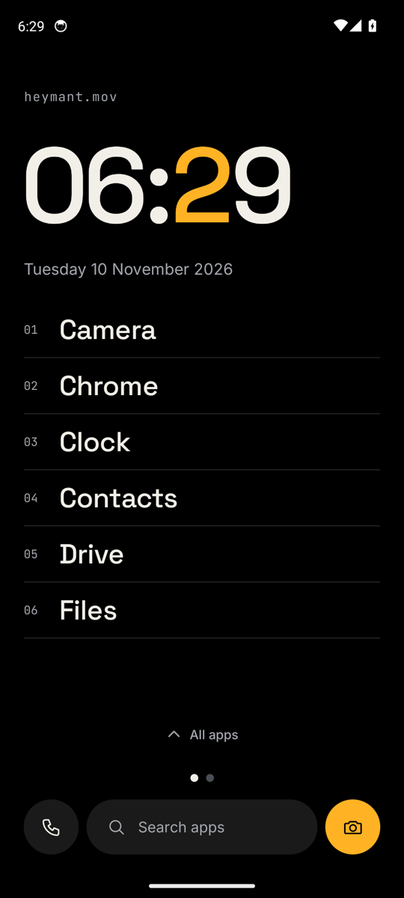
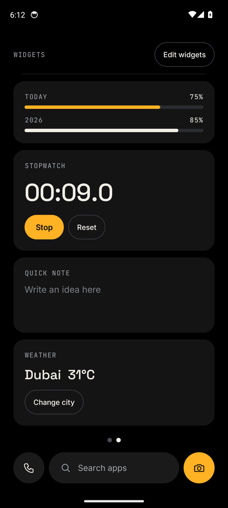
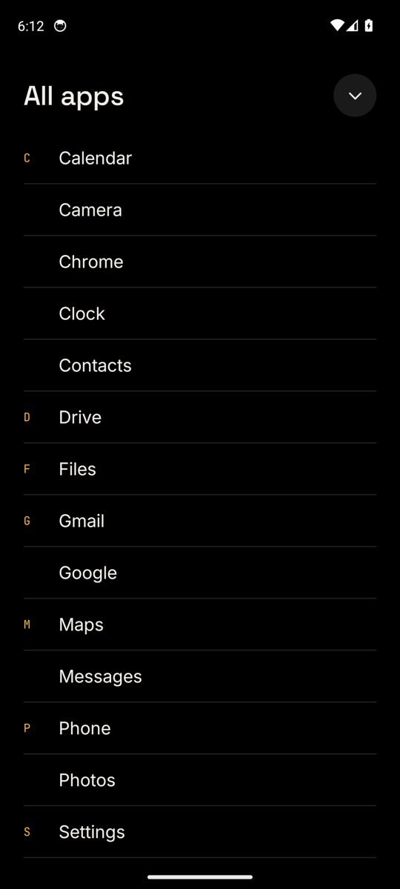
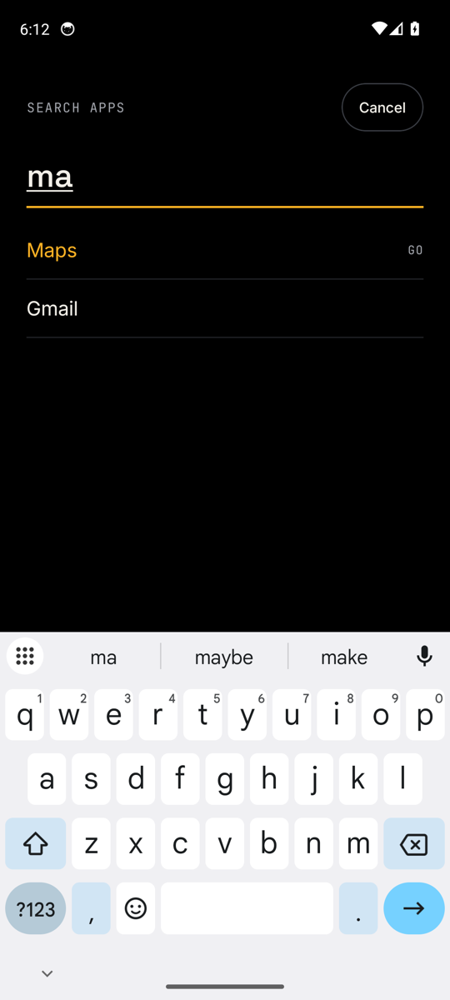

# Six Launcher

A calm, text-only home screen for Android. Pick six apps, see the time, and keep everything else one swipe away.

<p>
  
  
  
  
</p>

## Download

Get **Six-launcher.apk** from the [latest release](../../releases/latest).

Needs Android 8.0 or newer.

## What it does

- **Six apps of your choice**, shown as large text with no icons.
- **A big clock** with one highlighted digit, and the full date.
- **Your own label** at the top of the home screen.
- **A widgets page** one swipe to the right, with calendar, day and year progress, stopwatch, quick note and weather.
- **All apps and search**: swipe up for every app, or tap the search bar and press Go to open the first match.
- **Pitch black**, so it looks good on OLED screens.

Long-press an empty part of the home screen to edit your apps or the label. Long-press an app name to open its system info page.

## Install

1. Download `Six-launcher.apk` on your phone and open it.
2. Android will ask you to allow installs from your browser or file app. Allow it for this install.
3. Android may warn that the app is from an unknown developer, because it is not from the Play Store. Tap to install anyway.
4. Press the home button and choose **Six**, then **Always**.

To go back to your old home screen, open Settings, search for "Default apps", and change the Home app.

### If your old home screen flashes after unlocking

Some phones close home apps to save battery. Open Settings › Apps › Six › Battery and choose **Unrestricted** (or **No restrictions**). On Xiaomi phones, also lock Six in the recent apps screen.

## Privacy

Six does not collect, store or send any personal data, and has no ads or tracking. Your choices stay on your phone.

The only time it uses the internet is the Weather widget, if you add it. It then sends the city name you type to [Open-Meteo](https://open-meteo.com), a free weather service, to get the temperature.

## Check the download

Every release is signed with the same key. Its SHA-256 certificate fingerprint is:

```
e7:2f:41:80:a5:ab:77:8f:bc:e3:fb:d1:36:74:68:8c:2a:a6:f2:5a:2d:6b:d5:13:f0:c7:1a:eb:d4:cb:44:6e
```

## Fonts

Six uses [Space Grotesk](https://github.com/floriankarsten/space-grotesk), [Inter](https://github.com/rsms/inter) and [JetBrains Mono](https://github.com/JetBrains/JetBrainsMono), all under the SIL Open Font License 1.1. Their licences are in the [licenses](licenses) folder.

## Licence

Six Launcher is free to download and use. The source code is not published.

Made by [heymant.mov](https://www.instagram.com/heymant.mov/).
